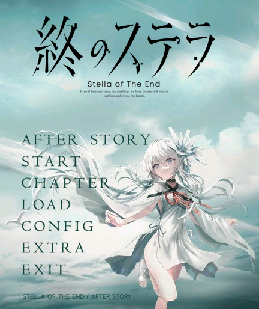
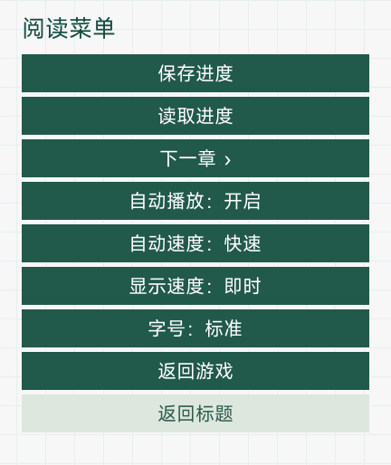
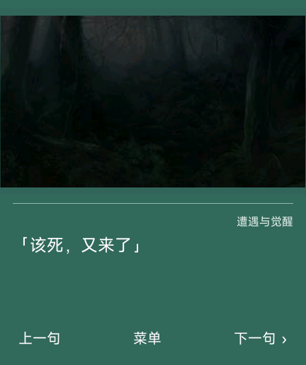
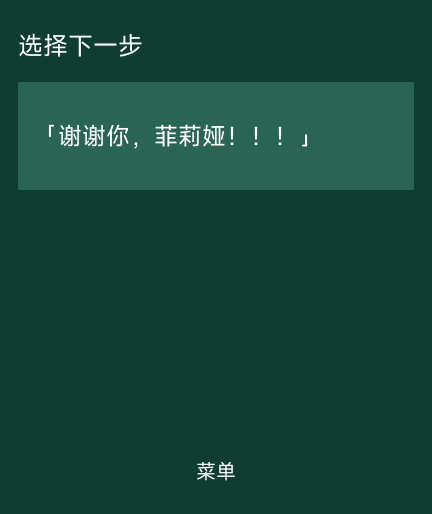

# 《星之终途》· REDMI Watch 5 标准版

当前版本 **0.2.4 / versionCode 6**，屏幕 432×514，包名 `com.codex.stella.rw5`。安装包 **12,212,833 字节（12.21 MB）**，解包后 13,464,142 字节。开发、转换与验证由 **OpenAI Codex** 完成；需求审查和实机反馈由维护者提供。

## 自动播放（0.2.4）

在剧情中打开“菜单”，点“自动播放：关闭”切换为开启，再点“返回游戏”。自动播放按约 **30 毫秒／字**显示；当前句逐字完成后，按所选档位等待，再进入下一句。

| 自动速度 | 逐字完成后的等待 |
| --- | --- |
| 慢速 | 2.6 秒 |
| 标准（默认） | 1.5 秒 |
| 快速 | 0.8 秒 |

点击“自动速度”循环切换三档。超过 60 字的段落，每多一字再延长 55 毫秒，最多额外 5 秒。自动时始终逐字显示；手动阅读原有的“即时／逐字”设置仍保留。

- 遇到选项时暂停，必须由玩家选择，之后继续；不会自动选择或绕过“谢谢你，菲莉娅”的确认。
- 打开菜单、存读档界面或切到后台时暂停；返回正文后从当前句重新等待。正文拖动时暂停，松手及惯性滚动结束后重新计时。
- 手动点击还没显示完的文本会补全当前句并重新等待；已显示完整时点击仍可推进。点“上一句”关闭自动播放，方便回看。
- 返回标题、剧情结束、报错或退出均取消自动推进。章节加载中切到后台不会漏掉下一章第一句；已取消的加载也不会在返回标题后重新打开剧情。
- **只保存速度档位；每次启动应用，自动播放默认关闭。** 不把自动开关写进存档或通关记录。

菜单保留保存、读取、下一章、显示速度、字号和返回入口；九个按钮均完整显示。沿用 0.2.3 的完整标题立绘，本次不重新压缩或裁剪 CG、剧情立绘和字体；剧情、选择目标及原有存档模块逐字节不变，见 `reports/autoplay-audit.json`。

## 功能

- START 进入正篇；正篇 9,424 段中文文本、21 个章节入口。
- 从 START 完成正篇后，AFTER STORY 在标题第一项出现，进入《渺茫希望的日记》。后日谈正常入口 1,392 段源文本、8 个章节入口；AE 结束后返回标题。157 段重复原作尾声保留作历史数据兼容，正常后日谈不重复衔接；原作尾声仍属于正篇。
- 30 个保存栏位，LOAD 自选栏位读取，覆盖前确认。手环与手表包名和存储键分离，不自动迁移跨设备存档。
- CHAPTER 提供路线和章节回看；菜单“下一章”必须停在尚未作出的选项处。章节回看不代替 START 通关。
- EXTRA 提供 256 组／394 张 CG，同场景差分在组内点击切换。
- 白色台词与纯浅墨绿色文本框，上方 CG 保持比例、以墨绿色渐变填充空隙。长文本自动换行并可滑动，拖动不推进，重新轻点可继续；逐字显示时先补全当前句，再点下一句。
- CONFIG 调整字号、显示速度；EXIT 调用系统接口退出应用。退出前自行保存。

## 体积与适配

保留标准版最高 320×256 的背景／CG 图像及全部透明剧情立绘。标题完整轮廓直接由原作透明图层提取，不使用生成式补画。

手表剧情字号为 24／28 像素，沿用现有字体处理。本版不含语音、音乐、视频或复杂动态演出，仍为图文阅读应用。按需加载剧情块，最多显示 3 张人物，回退历史保留 8 步。

包体 MB 使用十进制计量，不能视为实际安装空间或运行 RAM。轻量版与标准版同包名、同版本号，供选择安装，不能并存；新版本覆盖升级的数据保留仍需实机复测。

## 安装与异常处理

1. 使用[表盘自定义工具](https://www.bandbbs.cn/)安装 `星之终途-RW5-0.2.4.bin`；同版 `.rpk` 字节相同。
2. 手机传输结束后还需等待设备完成安装并显示图标，避免连续重复上传。
3. 为保留存档优先覆盖安装，主动卸载通常会清除本应用数据。安装前保留旧包与能够导出的存档备份。
4. 若黑屏、卡住或退出，先通过设备返回操作离开，必要时正常重启，再读取较早存档。可重复的问题需记录章节、触发操作、固件版本与包 SHA-256。
5. 若持续不显示图标，先停止重复上传，正常重启并检查安装状态；恢复出厂设置会清除数据，不作为首选处理。

## 验证范围

标准版和轻量版各通过 **28 项自动检查**：原有全文、章节、选项与存档检查，以及自动播放计时、选项暂停／恢复、菜单／后台／触摸暂停、长文等待、手动补全、保存读取、速度持久化、关闭重开、终止与异步加载取消检查。记录为 `reports/autoplay-tests.tap`。

每个精确安装包分别通过内外签名、摘要、CRC、1080 张图像解码、圆形透明图标和字体覆盖检查；新增菜单字形也核对了原生默认字体。`reports/autoplay-v023-baseline.json` 与 `reports/autoplay-audit.json` 核对本次源文件差异，原作资源保持不变。

**两版分别安装到官方通用 Vela 模拟器实测**。`native-test-results/auto-v024/report.json` 绑定各自安装包 SHA-256，覆盖九项菜单、三档速度、连续自动推进、菜单及 LOAD 暂停、真实长段落拖动后恢复、后日谈 107:423 选项停留／选择后恢复、上一句关闭自动、重开后默认关闭且速度保留。截图只代表对应的实际运行。

该环境为 `vela-watch-5.0`、432×514、128 MB，不代表 REDMI Watch 5 实际固件或 RAM。后台和异步加载等边界另有自动检查；历史 0.2.3 标题检查及更早报告不替代本版新验证。**维护者于 2026-10-20 确认本次 0.2.4 更新实机测试通过，并授权发布。** 实机反馈见 `reports/physical-confirmation-v024.json`；模拟器报告保留其原有验证范围。

## 构建与来源

Node.js 与兼容编译器 aiot-toolkit **1.1.0**：`npm install --prefix tools/compat-toolkit --ignore-scripts`，然后 `node tools/build.cjs`；已有工具链可设置 `WATCH_COMPAT_TOOLKIT`。图片保真后处理和签名重封装不可省略。自动检查运行 `node --test tests/reader.test.cjs tests/auto-reader.test.cjs`。包审核运行 `python tools/audit-package.py`，需可用的默认字库或显式传入该字库路径。

标题再生成工具为 `tools/remake-ui.py`，需要自行提供原作 UI 文件，或设置 `STELLA_GAME_ROOT` 指向持有的原作；发布源码含已生成资源，可直接构建。原作 Windows 游戏与其执行程序不包含在源码包中。正篇由 Artemis/PF8 数据转换，所提供后日谈由 RPA/RPYC 数据转换，不运行原游戏脚本中的任意代码。

原作：[《星之终途》Key 官网](https://key.visualarts.gr.jp/kinetic/stella/) · [Steam](https://store.steampowered.com/app/2510770/Stella_of_The_End/)。后日谈采用维护者提供的独立 Ren’Py 资源，不将其称为 Steam 官方 DLC。本项目非官方作品。

感谢 **@liuyuze61** 的[《ATRI》1.5.1 移植作品](https://api.bandbbs.cn/wftools/bandbbs.html?code=A&state=1820673)和[《星空列车与白的旅行》1.0.0 移植作品](https://api.bandbbs.cn/wftools/bandbbs.html?code=A&state=1841662)提供参考；感谢[表盘自定义工具相关团队](https://www.bandbbs.cn/)提供安装工具。

自编代码采用 MIT 许可证；原作剧情、图像、标识与第三方资源保留各自许可，字体许可证见 `licenses`。

## GitHub 版本入口

| 设备／版本 | 源码分支 | 下载 |
| --- | --- | --- |
| REDMI Watch 5 标准版 0.2.4 · 12.21 MB | [main](https://github.com/xuanyide01/stella-rw5/tree/main) | [0.2.4 Release](https://github.com/xuanyide01/stella-rw5/releases/tag/v0.2.4) |
| REDMI Watch 5 轻量版 0.2.4 · 9.88 MB | [rw5-lite](https://github.com/xuanyide01/stella-rw5/tree/rw5-lite) | [同一 Release](https://github.com/xuanyide01/stella-rw5/releases/tag/v0.2.4) |
| 小米手环 8 Pro 0.1.1 · 9.86 MB | [band8pro](https://github.com/xuanyide01/stella-rw5/tree/band8pro) | [手环 Release](https://github.com/xuanyide01/stella-rw5/releases/tag/band8pro-v0.1.1) |

本次 0.2.4 自动播放更新由维护者确认实机测试通过，按正式 Release 发布。标准版与轻量版同包名、同版本号，任选其一；本次未更新手环版本。

## 当前界面预览

| 自动播放菜单 | 连续自动阅读 | 选项暂停 |
| :---: | :---: | :---: |
|  |  |  |

以上截图来自本分支对应精确安装包的官方通用 Vela 模拟器检查。实机通过记录由维护者提供；两者分别留存。历史 [0.2.1 截图](docs/screenshots/v0.2.1/)继续保留。
