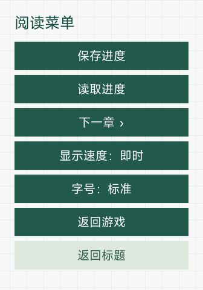

# 《星之终途》· 小米手环 8 Pro 手环版

当前版本 **0.1.1 / versionCode 2**，屏幕 336×480，包名 `com.codex.stella.band8pro`。安装包 **9,864,593 字节（9.86 MB）**，解包后 11,111,512 字节。开发、转换与验证由 **OpenAI Codex** 完成；需求审查和实机反馈由维护者提供。

## 本次修复

修复旧标题素材在 x=900 处裁剪、切断菲莉娅左侧披风的问题。沿原作透明层提取完整人物轮廓，排除独立的旅行者图层；不再用矩形裁剪穿过衣物。完整轮廓按同一个缩放系数调整宽高，全部保留在屏幕内，下沿贴住屏幕底部，人物主体与脸部仍位于右侧。标题的天空、标识、原版英文选项字形、透明按钮和严格左对齐布局延续现有风格。手环版同时修正完整人物构图与比例。

本版只更新 `src/common/ui/title.jpg` 和版本元数据。剧情、原有游戏 CG、透明剧情立绘、字体、选项、存档与页面运行代码和各自上一版保持一致，差异清单见 `reports/title-complete-audit.json`。

## 功能

- START 进入正篇；正篇 9,424 段中文文本、21 个章节入口。
- 从 START 完成正篇后，AFTER STORY 在标题第一项出现，进入《渺茫希望的日记》。后日谈正常入口 1,392 段源文本、8 个章节入口；AE 结束后返回标题。157 段重复原作尾声保留作历史数据兼容，正常后日谈不重复衔接；原作尾声仍属于正篇。
- 30 个保存栏位，LOAD 自选栏位读取，覆盖前确认。手环与手表包名和存储键分离，不自动迁移跨设备存档。
- CHAPTER 提供路线和章节回看；菜单“下一章”必须停在尚未作出的选项处。章节回看不代替 START 通关。
- EXTRA 提供 256 组／394 张 CG，同场景差分在组内点击切换。
- 白色台词与纯浅墨绿色文本框，上方 CG 保持比例、以墨绿色渐变填充空隙。长文本自动换行并可滑动，拖动不推进，重新轻点可继续；逐字显示时先补全当前句，再点下一句。
- CONFIG 调整字号、显示速度；EXIT 调用系统接口退出应用。退出前自行保存。

## 体积与适配

采用 767 张最高 300×240、quality 61 的轻量 JPEG；299 张透明剧情立绘 PNG 保留，无再次压缩或新增裁剪。标题完整轮廓直接由原作透明图层提取，不使用生成式补画。

手环剧情字号为 22／26 像素，通常文本不显式绑定字体族，罕用字使用静态绑定的补充字体，沿用已验证的方框字修复。本版不含语音、音乐、视频或复杂动态演出，仍为图文阅读应用。按需加载剧情块，最多显示 3 张人物，回退历史保留 8 步。

包体 MB 使用十进制计量，不能视为实际安装空间或运行 RAM。轻量版与标准版同包名、同版本号，供选择安装，不能并存；新版本覆盖升级的数据保留仍需实机复测。

## 安装与异常处理

1. 使用[表盘自定义工具](https://www.bandbbs.cn/)安装 `星之终途-Band8Pro-0.1.1.bin`；同版 `.rpk` 字节相同。
2. 手机传输结束后还需等待设备完成安装并显示图标，避免连续重复上传。
3. 为保留存档优先覆盖安装，主动卸载通常会清除本应用数据。安装前保留旧包与能够导出的存档备份。
4. 若黑屏、卡住或退出，先通过设备返回操作离开，必要时正常重启，再读取较早存档。可重复的问题需记录章节、触发操作、固件版本与包 SHA-256。
5. 若持续不显示图标，先停止重复上传，正常重启并检查安装状态；恢复出厂设置会清除数据，不作为首选处理。

## 验证范围

本版 17 项自动检查通过，覆盖全文顺序、章节入口、选项保护、30 个存档键、目录刷新、通关解锁和长文本操作逻辑。实际包的内外签名、文件摘要、CRC、1080 张图像解码、圆形透明图标、字体覆盖均通过。

`reports/title-complete-audit.json` 独立重建原作透明轮廓与标题 JPG，校验完整衣物、宽高比、轮廓全部位于屏幕内、贴底及实际模拟器像素；`native-test-results/title-band-v011/report.json` 记录本版精确 SHA-256 的原生检查，覆盖标题、START、菜单、LOAD 列表、CG、EXIT 重开与已解锁 AFTER STORY。

原生环境是官方通用 `vela-watch-5.0` 模拟器、336×480、128 MB，不能视为目标设备固件或其 RAM 规格。本次属于标题素材更新的回归检查；之前完整游戏流程与冷启动报告为历史证据，不将它们计作本版新实测。**本版尚待实机复测。**

## 构建与来源

Node.js 与兼容编译器 aiot-toolkit **1.1.0**：`npm install --prefix tools/compat-toolkit --ignore-scripts`，然后 `node tools/build.cjs`；已有工具链可设置 `WATCH_COMPAT_TOOLKIT`。图片保真后处理和签名重封装不可省略。自动检查运行 `node --test tests/reader.test.cjs`。包审核运行 `python tools/audit-package.py`，需可用的默认字库或显式传入该字库路径。

标题再生成工具为 `tools/remake-ui.py`，需要自行提供原作 UI 文件，或设置 `STELLA_GAME_ROOT` 指向持有的原作；发布源码含已生成资源，可直接构建。原作 Windows 游戏与其执行程序不包含在源码包中。正篇由 Artemis/PF8 数据转换，所提供后日谈由 RPA/RPYC 数据转换，不运行原游戏脚本中的任意代码。

原作：[《星之终途》Key 官网](https://key.visualarts.gr.jp/kinetic/stella/) · [Steam](https://store.steampowered.com/app/2510770/Stella_of_The_End/)。后日谈采用维护者提供的独立 Ren’Py 资源，不将其称为 Steam 官方 DLC。本项目非官方作品。

感谢 **@liuyuze61** 的[《ATRI》1.5.1 移植作品](https://api.bandbbs.cn/wftools/bandbbs.html?code=A&state=1820673)和[《星空列车与白的旅行》1.0.0 移植作品](https://api.bandbbs.cn/wftools/bandbbs.html?code=A&state=1841662)提供参考；感谢[表盘自定义工具相关团队](https://www.bandbbs.cn/)提供安装工具。

自编代码采用 MIT 许可证；原作剧情、图像、标识与第三方资源保留各自许可，字体许可证见 `licenses`。

## GitHub 版本入口

| 设备／版本 | 源码分支 | 下载 |
| --- | --- | --- |
| REDMI Watch 5 标准版 0.2.3 · 12.21 MB | [main](https://github.com/xuanyide01/stella-rw5/tree/main) | [手表 Release](https://github.com/xuanyide01/stella-rw5/releases/tag/v0.2.3) |
| REDMI Watch 5 轻量版 0.2.3 · 9.88 MB | [rw5-lite](https://github.com/xuanyide01/stella-rw5/tree/rw5-lite) | [同一手表 Release](https://github.com/xuanyide01/stella-rw5/releases/tag/v0.2.3) |
| 小米手环 8 Pro 0.1.1 · 9.86 MB | [band8pro](https://github.com/xuanyide01/stella-rw5/tree/band8pro) | [手环 Release](https://github.com/xuanyide01/stella-rw5/releases/tag/band8pro-v0.1.1) |

当前发布为待实机复测版本（Pre-release）。手表标准版与轻量版同包名、同版本号，任选其一安装；手环版使用独立包名。历史 [v0.2.1](https://github.com/xuanyide01/stella-rw5/releases/tag/v0.2.1) 实机通过记录保留，不计作当前标题修复版实测。源码与转换由 Codex 完成。

## 当前界面预览

| 阅读界面 | 菜单 | CG 鉴赏 |
| :---: | :---: | :---: |
|  |  |  |

以上为当前精确安装包的 Vela 原生模拟器截图。此前新增的 [0.2.1 历史截图目录](docs/screenshots/v0.2.1/)原文件继续保留。

## 联系方式

问题反馈与交流：[shining237841@gmail.com](mailto:shining237841@gmail.com)。
