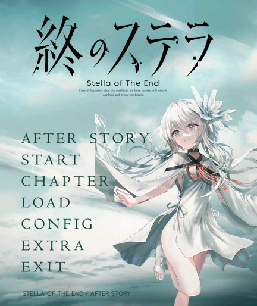
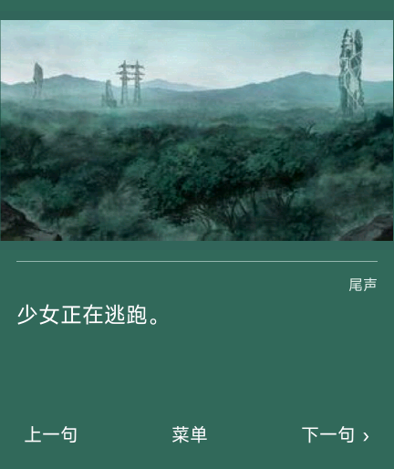
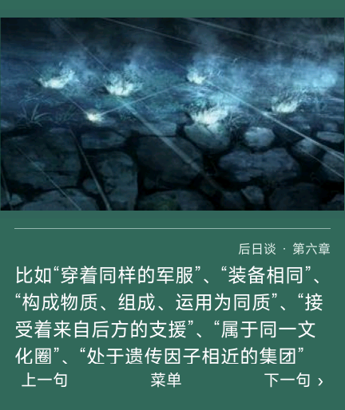
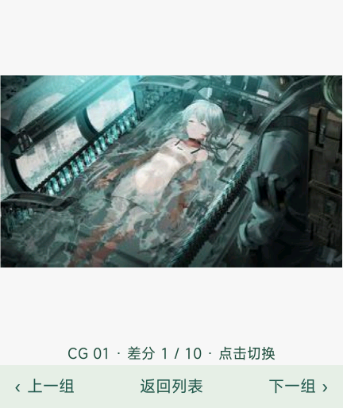
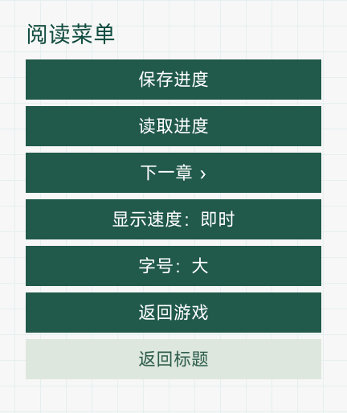
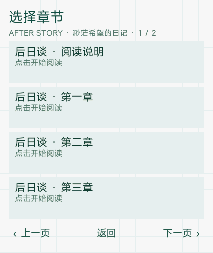
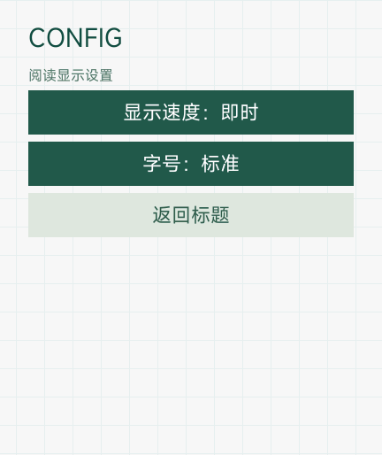

# 《星之终途》· 红米手表 5 图文版

将本地持有的《星之终途》正篇及所提供的 Ren’Py 后日谈《渺茫希望的日记》整合为 Xiaomi Vela 图文阅读应用。程序、转换工具、界面适配与检查由 **OpenAI Codex** 完成，需求审查及实机测试由项目维护者提供。

原作：[Key 官网](https://key.visualarts.gr.jp/kinetic/stella/) · [Steam](https://store.steampowered.com/app/2510770/Stella_of_The_End/)。这是非官方移植；后日谈采用用户提供的独立 Ren’Py 游戏资源，不将其称为 Steam 官方 DLC。

## 当前版本

**0.2.1 / versionCode 3**；目标设备为 **REDMI Watch 5，432 × 514**；包名仍为 `com.codex.stella.rw5`，名称仍为「星之终途」，保留圆形透明图标。

安装包 **12,213,953 字节（12.21 MB）**，低于 **15,000,000 字节**上限；解包后文件总计 **13,462,759 字节**，实际安装还需额外的文件系统及更新临时空间。

**0.2.1 已由维护者确认实机测试通过（2026-10-13）。** 测试文件 SHA-256 为 `86d23d2f7824dd97750ebcae47bb71f16bdc1d6975c7f479becb556fa0744a31`，反馈记录见 `reports/physical-confirmation-v021.json`。已通过 17 项自动检查、源文本独立校对、图片及字体覆盖、双层签名和 ZIP 检查；原生模拟器范围见 `native-test-results/v021/report.json`。

## 界面截图

以下展示 **0.2.1 红米手表移植版**的实际界面，尺寸均为 **432 × 514**。标题图保留维护者提供的完整 PNG 原文件，未缩放或重新编码；其画面与该版本原生模拟器截图一致。其余图片取自该版本的 Vela 原生模拟器检查记录，属于程序运行截图。标题展示正篇通关后解锁 AFTER STORY 的状态。

<p align="center">
  <a href="docs/screenshots/v0.2.1/title.png"></a>
</p>

| 正篇阅读界面 | 后日谈长文本界面 |
| :---: | :---: |
| <a href="docs/screenshots/v0.2.1/game-main.png"></a> | <a href="docs/screenshots/v0.2.1/game-after-story.png"></a> |
| **CG 鉴赏与差分浏览** | **阅读菜单** |
| <a href="docs/screenshots/v0.2.1/cg-appreciation.png"></a> | <a href="docs/screenshots/v0.2.1/reading-menu.png"></a> |
| **章节选择** | **阅读设置** |
| <a href="docs/screenshots/v0.2.1/chapter-selection.png"></a> | <a href="docs/screenshots/v0.2.1/settings.png"></a> |

点击图片可查看原尺寸 PNG；全部文件位于 [截图目录](docs/screenshots/v0.2.1/)。

## 合并内容与界面

- 正篇保留 51 个源剧情文件的 **9,424 段中文文本**与 **21 个章节入口**。原有 30 个剧情块文件逐字节保持不变，章节编号及存储键延续旧版。
- 标题首项 **AFTER STORY** 在从 START 完成正篇通关后才出现，进入《渺茫希望的日记》。后日谈提供 **8 个章节入口**：阅读说明、六个故事章节及附加故事；正常入口共 **1,392 段可读源文本**（主线 1,377 段、附加故事 15 段），另保留片尾动画省略提示。
- 后日谈确认选项后的 `AE` 段落读完，自动返回标题。所提供后日谈包的 `a7`“终章”重复正篇尾声，因此不再从 AFTER STORY 自动接入，也不在后日谈章节目录重复列出。正篇原有第 21 章尾声完整保留；`a7` 的 **157 段文本**及编号 108 留作旧版存档兼容。全部 1,549 段已转换源文本仍可独立校对。
- 后日谈原脚本的唯一确认选项 **「谢谢你，菲莉娅！！！」** 保留，目标仍对应 `AE` 段落。菜单“下一章”会停在该选项处，重复使用也不能绕过，存档／读档保持待选状态。
- 标题使用原作的**天空与人物背景**，菲莉娅裁出并放大至 370 px 高，位于右侧及标题标识下方，下沿与屏幕底部相接，选项背板为**透明**，沿用原作标识和按钮字形。所有入口按实际可见字形统一左对齐：**AFTER STORY、START、CHAPTER、LOAD、CONFIG、EXTRA、EXIT**；AFTER STORY 使用原作已有字形组合，去除透明内边距造成的偏移；七项采用同一 0.62 缩放比例，可见字形高度统一为 18 px。未通关时隐藏 AFTER STORY 并收拢菜单，章节目录也隐藏后日谈路线。
- 剧情文字为**白色**，文本框采用**浅墨绿色纯色**与细线。上方 CG 保持比例完整显示，上下留白由相近的墨绿色渐变填充；菜单、存档、目录及 CG 鉴赏统一为白色／墨绿色科技风，背景连续延伸至顶部，移除底部加粗装饰横条。
- 长段落**自动换行、上下滑动浏览**；纵向拖动不推进剧情，重新点击文本框仍按通常阅读规则继续（逐字显示时先补全当前句，再点进入下一句）。新句及回退至前句都从文本顶部开始。
- **30 个共享保存栏位**可保存正篇或后日谈，手动选择栏位保存与读取，覆盖前确认。保留旧版键 `stella_rw5_slot_v1_*`，旧正篇存档可继续读取；后日谈使用独立章节编号 101—109。
- **CHAPTER** 先选择正篇或后日谈，再选择章节。路线／章节第一页、返回与翻页均使用独立条目标识，防止首次切换停留在旧内容。
- **EXTRA** 提供 **256 组／394 张**图片，包含原有 308 张及后日谈新增 86 张；同场景差分在组内点击切换。全部鉴赏图片开放，无需解锁。
- **CONFIG** 可设置字号和逐字／即时显示；**EXIT** 调用 Vela `$app.exit()` 退出。退出不代替保存，请在离开剧情前保存到栏位。

## 安装与使用

1. 使用[表盘自定义工具](https://www.bandbbs.cn/)向 REDMI Watch 5 安装 `星之终途-RW5-0.2.1.bin`；同版 `.rpk` 内容完全相同。
2. **手机蓝牙传输结束后仍需等待一阵，设备才会完成安装并显示图标。** 不要在安装未完成时连续上传。
3. 希望保留旧存档时优先覆盖安装；主动卸载通常会清除本应用数据。升级前应保留旧安装包与能够导出的存档备份。
4. START 进入正篇，AFTER STORY 进入后日谈；LOAD 自选栏位读取。阅读中点画面或“下一句”继续，点“菜单”保存、读取、切换显示或安全跳到下一章。
5. 从 START 完成正篇后解锁 AFTER STORY，并自行作出后日谈确认。旧版正篇已读完但尚无解锁记录时，可读取最后一个正篇流程存档并再读至结束；单独回看第 21 章不解锁。通关标记沿用既有进度键，重开应用后保留。CHAPTER 是回看入口，不代替完整流程。

## 技术范围与压缩

正篇使用 Artemis/PF8 字面量 AST 转换，后日谈使用 RPA3 索引与 RPYC2 语法数据转换。工具不运行原游戏 EXE、Ren’Py 脚本中的 Python 或任意 Lua/TJS；RPA 不允许反序列化全局对象，RPYC 仅映射白名单语法对象为惰性数据。

为控制体积及运行开销，本版不包含语音、音乐、视频或复杂动态特效。后日谈片尾保留省略提示并返回标题，附加故事读完也返回标题。镜头移动、缩放、滤镜和定时过渡简化为静态构图；原作的成就弹窗及语言选择弹窗不在手表中复现。正篇和后日谈均保留原小说式文本，原段落没有独立人物标签时不会擅自拆写人名。

场景与 CG 最高 320 × 256，常见画面为 320 × 180 JPEG；人物裁去部分下部以突出头部和上半身，保留透明度的 PNG 最高 200 × 256。每次仅加载一块剧情（最多 512 条），历史回退保留最近 8 步，最多显示 3 张人物。编译后再次核对最终 PNG／JPEG 与源文件一致，避免工具二次有损压缩。原作部分高幅画面采用静态裁切，不能将本版称为完整演出复刻。

## 验证材料

| 范围 | 记录 |
| --- | --- |
| 原有正篇全文、顺序及章节 | `reports/text-provenance.json`、`tests/reader.test.cjs` |
| 正篇 30 个剧情块不变、旧存档位置 | `reports/after-story-baseline.json`、自动检查 |
| 后日谈源文本独立核对 | `reports/after-source-audit.json`、`reports/after-text-provenance.json` |
| 唯一确认选项原文及目标 | `reports/after-choice-source.json`、自动检查与原生检查 |
| 转换数量、源脚本摘要和演出边界 | `reports/after-conversion.json`、`reports/conversion.json` |
| 原版界面来源及样式 | `reports/ui-remake.json` |
| 精确安装包、签名、图标、字体、图片 | `reports/package-audit.json` |
| 本版冷启动升级、旧槽 01／30、长文本滑动和点击、结束、退出 | `native-test-results/v021/report.json`及对应截图 |
| 0.2.0 的历史完整 30 槽冷启动恢复 | `native-test-results/v020/report.json`，不替代本版完整 30 槽实测 |

官方模拟器为 `vela-watch-5.0`、432 × 514、128 MB，并非 REDMI Watch 5 实际固件。本版在完整冷启动后覆盖安装并验证旧存档 01 与仍待确认的 30，使用真实剧情 107:110 验证 24／28 px 两种字号的换行、纵向拖动和点击。最终包沿用已通关模拟器数据，重新完成 START 流程并验证第一项后日谈入口；未通关隐藏状态由自动检查及同一页面代码的 c246905d 候选包原生截图核对，记录位于 native-test-results/v021-second。首个 0.2.1 候选包的测试在 EXIT 后立即调用模拟器 API 重开时，调试服务 inspector 的 uv_loop_init 出现异常；记录保留于 reports/native-v021-first-exit.json，不能将该次运行称为完整通过。最终验证在生命周期清理结束后再重开，等待新页面 onShow 与背景加载，然后仅在全黑时发送虚拟电源键。候选包重开后的黑屏已在唤醒后恢复，解锁标记仍保留；相应失败材料位于 native-test-results/v021-second 和 v021-third。历史 0.2.0 的初次黑屏及热重装异常记录保留于 `reports/native-v020-first-boot.json`，其成功的完整 30 槽检查也保留。0.1.0-r1 的历史资料保留于 `docs/history/README-v010-r1.md`。

长文本使用 Vela 原生 [text](https://iot.mi.com/vela/quickapp/zh/components/basic/text.html) 与 [scroll](https://iot.mi.com/vela/quickapp/zh/components/container/scroll.html)，不限行数；新句通过 `scrollTo({top:0})` 复位，并依据[触摸事件](https://iot.mi.com/vela/quickapp/zh/components/general/events.html)区分拖动和轻点。没有按固定字数改写原作段落。

## 异常处理

- 应用黑屏、退出或无响应：通过设备返回操作离开应用，重新打开并读取较早存档；不要连续快速点击。设备仍可操作时可正常重启。
- 某章节无法读取：返回标题选择相同章节重试，或读取其他栏位；重复出现时记录章节、触发操作、固件和安装文件 SHA-256。
- 传输完成后没有图标：先等待设备端处理，再正常重启并用同版文件重试。若旧版和其他已知可安装应用也同时失败，应检查设备安装状态；历史上重置系统曾恢复安装，但重置会清除数据，应作为最后的恢复手段。
- 如需退回版本，保留旧 0.1.0-r1 文件；卸载后重装可能清除所有存档。后日谈存档无法由旧正篇版识别。

本项目仅使用普通 Vela 应用安装，不修改手表固件；现有检查不构成对所有场景或固件绝无异常的保证。

## 构建与再次转换

已转换资源在 `src/common/`；正常构建不需要原游戏或后日谈归档。

```powershell
npm test
npm install --prefix tools/compat-toolkit --ignore-scripts
npm run build
```

安装兼容工具前，按 `tools/compat-toolkit/package.json` 的锁定版本处理；实际安装包使用 **aiot-toolkit 1.1.0**。构建脚本检查工具版本、手表清单，并执行与已通过实机版本相同的兼容封装。也可用 `WATCH_COMPAT_TOOLKIT` 指定已有同版工具。

再次转换正篇需设置 `STELLA_GAME_ROOT` 后执行 `tools/convert.py`；随后按 `tools/complete-gallery.py` 的规则补齐该版资源。再次合并后日谈需将 `STELLA_AFTER_ROOT` 指向含 `game/archive.rpa` 的内层目录并执行 `tools/convert-after-story.py`。重建原版 UI 时设置 `STELLA_GAME_ROOT` 并执行 `tools/remake-ui.py`。字形补集生成使用 OFL 的 Noto Sans Mono CJK SC，运行 `tools/build-text-font.py`；模拟器系统字体只用于覆盖分析，不随本项目分发。

`tools/emulator-server.cjs` 支持独立 `WATCH_VVD_NAME`、`WATCH_CONTROL_PORT`、`WATCH_SERIAL_PORT`、`WATCH_GRPC_PORT` 和 `WATCH_DEBUG_PORT`。当前开发检查器默认控制页为 `http://127.0.0.1:43135/`，只监听本机。再次检查需使用对应 SDK、环境路径及控制端口。

## 致谢与权利归属

感谢 Key、原作编剧、美术与译者，以及所提供后日谈作品的制作、汉化和素材贡献者。后日谈资源内说明称其依据原作实体特典剧本制作；这里保留该来源说明，不据此推定其全部素材获得再分发许可。

感谢 @liuyuze61 的[《ATRI》1.5.1 移植](https://api.bandbbs.cn/wftools/bandbbs.html?code=A&state=1820673)、[《星空列车与白的旅行》v1.0.0 移植](https://api.bandbbs.cn/wftools/bandbbs.html?code=A&state=1841662)及 [ATRI-miband](https://github.com/liuyuze61/ATRI-miband) 提供参考；感谢[表盘自定义工具及米坛社区](https://www.bandbbs.cn/)相关团队、GARbro 格式实现、Vela 开发工具与字体项目。

自编代码采用 MIT 许可证。原作及后日谈文本、图像、商标与第三方字体不因该许可证取得 MIT 授权；对应说明见 `THIRD_PARTY_NOTICES.md` 与 `licenses/`。本版发布为 [v0.2.1](https://github.com/xuanyide01/stella-rw5/releases/tag/v0.2.1)，历史 v0.1.0-r1 安装包与 Release 保留。
